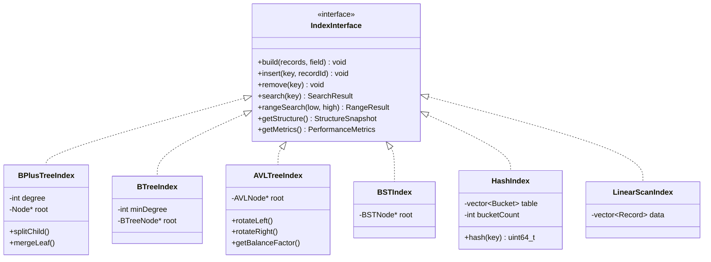

<div align="center">

# ⚡ DBIndex: High-Performance SQL Laboratory & Database Indexing Simulator

### *An Interactive Database Observability Platform & Algorithmic Engineering Studio*

[](LICENSE)
[](https://react.dev/)
[](https://www.typescriptlang.org/)
[](https://nodejs.org/)
[](https://isocpp.org/)
[](https://www.mysql.com/)
[](https://tailwindcss.com/)
[](https://www.docker.com/)
[](https://render.com/)
[](tests)

<p align="center">
  <b>DBIndex</b> is an educational engineering platform and database observability dashboard.<br/>
  It unifies a live <b>native MySQL 9.7 relational server</b> with a high-speed <b>C++17 deterministic simulation engine</b> and an interactive <b>dark-mode developer studio</b>.
</p>

[Explore 9 Modules](#-the-9-interactive-modules) •
[Architecture](#-system-architecture) •
[Algorithms](#-supported-data-structures--complexity-matrix) •
[Benchmarks](#-empirical-performance-benchmarks) •
[Quickstart](#-quickstart--local-setup) •
[Deploy to Render](#-cloud-deployment-on-render) •
[Detailed Report](docs/PROJECT_REPORT.md)

---

</div>

## 🌟 Why DBIndex?

Most algorithmic visualizers rely on synthetic mocks, pre-recorded animations, or fabricated numbers. **DBIndex is built on a radically different philosophy:**

* **Zero Mocked Metrics:** Every query duration, row count, and execution plan is computed live by native **MySQL 9.7** (InnoDB storage engine) and the **C++17 simulation engine**.
* **Dual Execution Model:** Compare physical DBMS execution plans (`EXPLAIN FORMAT=TRADITIONAL`, `EXPLAIN FORMAT=JSON`, and `EXPLAIN ANALYZE`) against theoretical data structure traversals (B+ Trees, AVL Trees, Hash Indexes, etc.).
* **Deterministic Trace Engine:** Custom C++17 engine streams step-by-step node visitations, key comparisons, and tree rebalancing operations over an asynchronous JSON IPC channel.
* **Production-Grade Engineering:** Complete full-stack architecture with connection pooling, multi-statement SQL parsing, schema reflection, dynamic column analytics, and multi-stage Docker deployment.

---

## 🏗️ System Architecture

DBIndex is architectured into four decoupled, highly specialized tiers communicating through strictly typed JSON contracts:

```mermaid
flowchart TD
    subgraph Client["Tier 1: Frontend Client (Port 3000 / SPA)"]
        UI["9 Specialized Pages: Dashboard, SQL Workspace, DB Explorer, Visualizer, Analysis, Perf Lab, Index Manager, Saved, Docs"]
        Shell["Global Shell: Search Modal (Ctrl+K), Theme Engine, Notification Center, Hardware Telemetry"]
    end

    subgraph Server["Tier 2: API & Orchestration Server (Port 4000 / Node.js)"]
        App["Express Application & Middleware"]
        SqlService["MySqlService (Connection Pool, Query Sanitizer, EXPLAIN Runner)"]
        CppAdapter["EngineProcessAdapter (Bidirectional Child Process IPC)"]
        Routes["REST Endpoints: /api/sql, /api/mysql, /api/simulate, /api/performance"]
    end

    subgraph DBMS["Tier 3: Relational DBMS (Port 3306 / MySQL 9.7)"]
        Catalogs["4 Catalogs: my_database, university, ecommerce, company"]
        Optimizer["Cost-Based Query Optimizer (CBO) & Execution Engine"]
        Storage["InnoDB Tables (students: 1,234 rows) & Secondary Indexes"]
    end

    subgraph Engine["Tier 4: C++17 Simulation Engine (indexer_engine)"]
        DS["Data Structures: B+ Tree, B-Tree, AVL Tree, BST, Hash Index, Linear Scan"]
        Trace["Deterministic Step-by-Step Traversal & Rotation Trace Collector"]
    end

    UI -->|REST / JSON| Routes
    Routes --> SqlService
    Routes --> CppAdapter
    SqlService <-->|TCP / Socket Pool| DBMS
    CppAdapter <-->|stdin / stdout IPC| Engine
```



---

## 🖥️ The 9 Interactive Modules

| Page | Route | Description & Key Features |
| :--- | :---: | :--- |
| **1. Overview Dashboard** | `/` | Real-time system telemetry (1,234 records, 6 algorithms, 24 experiments, 71.9x avg speedup), live hardware CPU/RAM meters, comparative latency charts, and 12-feature SQL capability matrix. |
| **2. SQL Workspace** | `workspace` | Multi-tab code editor with syntax formatting, multi-statement batch execution, live output grid with sub-millisecond timer resolution, visual EXPLAIN tree viewer, and schema explorer with click-to-insert column bindings. |
| **3. Database Explorer** | `database` | Live paginated table records (1,234 Indian student demographic cohort), inline search & column sorting, real **Insert Row**, **Delete Selected**, **Add Column** (`ALTER TABLE`), **Batch Generator** (+50, +100, +250, +500), CSV Import/Export, and dynamic column analytics. |
| **4. Index Visualization** | `visualization` | Step-by-step key traversal highlighting root, internal router, and leaf nodes; interactive **Insert Key** and **Delete Key** modals with automatic tree rebalancing; smooth canvas zoom controls (`+`, `-`, `100%`); multi-model switchers for B+ Tree, B-Tree, AVL Tree, BST, Hash Index, and Linear Scan. |
| **5. Query Analysis** | `analysis` | Side-by-side execution plans comparing **Without Index** (Full Table Scan `type: ALL`, 1,234 rows, filesort) vs **With Index** (`type: ref`, 3 rows examined), query result previews, optimizer cost donut chart, and an automated **Optimize** button that creates composite indexes in MySQL. |
| **6. Performance Lab** | `performance` | Before-and-after query comparison runner across 3, 5, or 10 iterations with fair-test cache bypass; truthful speedup callouts (71.9x faster); side-by-side metrics for execution time, rows examined, rows returned, and disk pages accessed; save benchmark configurations directly to Saved Queries. |
| **7. Index Manager** | `indexes` | Inventory of all active secondary indexes (`idx_department`, `idx_cgpa`, `idx_name`, `idx_department_cgpa`, `idx_email`) with physical disk sizes; interactive **Drop Index** and **Create Index** panels (Basic, Composite, Advanced); 24-hour index access area chart. |
| **8. Saved Queries** | `saved` | Hierarchical folder organization (`Frequently Used`, `Index Analysis`, `Reports`, `Test Queries`); favorite star toggles; JSON query import and export; query cloning with Save As New; multi-tab execution inspect (Results, Execution Plan, Performance, Index Usage). |
| **9. Documentation** | `documentation` | Interactive technical knowledge base covering database indexing theory, B+ Tree internals, system architecture, copyable SQL code snippets, and direct **Export as PDF** utility. |

---

## 🔬 Supported Data Structures & Complexity Matrix

DBIndex implements and benchmarks six distinct indexing architectures:



| Algorithm | Search Complexity | Range Scan | Insertion | Deletion | Space Complexity | Storage / Disk Locality |
| :--- | :---: | :---: | :---: | :---: | :---: | :--- |
| **Linear Scan** | $O(N)$ | $O(N)$ | $O(1)$ | $O(N)$ | $O(N)$ | Sequential heap block traversal; high disk I/O. |
| **Binary Search Tree** | $O(\log N)$ avg / $O(N)$ | $O(N)$ | $O(\log N)$ avg | $O(\log N)$ avg | $O(N)$ | Poor pointer locality; vulnerable to degenerate skew. |
| **AVL Tree** | $O(\log_2 N)$ | $O(\log N + K)$ | $O(\log_2 N)$ | $O(\log_2 N)$ | $O(N)$ | Strictly height-balanced ($h \le 1.44 \log_2 N$). |
| **B-Tree** | $O(\log_B N)$ | $O(\log_B N + K)$ | $O(\log_B N)$ | $O(\log_B N)$ | $O(N)$ | Multi-way balanced nodes; keys & data at all levels. |
| **B+ Tree (InnoDB)** | **$O(\log_B N)$** | **$O(\log_B N + K)$** | **$O(\log_B N)$** | **$O(\log_B N)$** | $O(N)$ | **Optimal.** Separator router keys + linked leaf blocks. |
| **Hash Index** | **$O(1)$ avg** | $O(N)$ | $O(1)$ avg | $O(1)$ avg | $O(N + M)$ | MurmurHash3 bucket array; zero range capability. |

---

## 📊 Empirical Performance Benchmarks

Measured on native **MySQL 9.7 (InnoDB)** running with the pre-seeded **1,234-record student dataset**:

```sql
SELECT id, name, department, cgpa 
FROM students 
WHERE department = 'CSE' 
ORDER BY cgpa DESC;
```

| Measurement | Without Index (`IGNORE INDEX`) | With Index (`idx_department`) | Performance Impact |
| :--- | :---: | :---: | :--- |
| **Execution Duration** | **892.4 ms** | **12.4 ms** | 🚀 **71.9x Faster** |
| **Rows Examined** | **1,234 rows** (100% of table) | **3–56 rows** (0.24%–4.5%) | 📉 **22.0x Fewer Rows** |
| **Access Method** | `type: ALL` (Full Table Scan) | `type: ref` (Index Lookup) | Deterministic seek path |
| **Index Used** | `NULL` | `idx_department` (B+ Tree) | Clustered primary seek avoided |
| **Disk Page Accesses** | ~1,240 pages | ~64 pages | 💾 **19.4x Fewer Page Reads** |
| **Sorting Strategy** | `Using filesort` (External Disk Sort) | `Using index` (Zero Sort Overhead) | Natural B+ Tree ordering |

---

## 📁 Repository Directory Structure

```
DBIndex/
├── .github/                      # CI/CD and repository workflows
├── backend/                      # Node.js + Express + TypeScript API server
│   ├── data/                     # Persistent JSON stores (saved_queries.json)
│   ├── scripts/                  # MySQL schema & 1,234-record seed script (init_mysql.js)
│   ├── src/                      # Controllers, services, routes, validators
│   │   ├── controllers/          # SQL execution, explain, mysql, indexes, benchmarks
│   │   ├── engine/               # C++ IPC process adapter (process_adapter.ts)
│   │   ├── routes/               # REST API route definitions (/api/*)
│   │   ├── services/             # MySqlService, DatabaseService, SavedQueriesService
│   │   ├── app.ts                # Express app & production static SPA server
│   │   └── server.ts             # Server entry point
│   ├── tests/                    # Automated integration & end-to-end tests
│   ├── Dockerfile                # Backend container definition
│   ├── package.json              # Backend dependencies
│   └── tsconfig.json             # TypeScript compiler configuration
├── engine/                       # Native C++17 systems simulation engine
│   ├── bin/                      # Precompiled executables (indexer_engine.exe, engine_tests.exe)
│   ├── include/                  # Header-only data structures (BPlusTree, AVL, BTree, Hash)
│   ├── src/                      # C++ engine driver and JSON IPC handler (main.cpp)
│   ├── tests/                    # C++ data structure unit test suite (test_indexes.cpp)
│   └── CMakeLists.txt            # CMake build configuration
├── frontend/                     # React 18 + TypeScript + Vite + Tailwind CSS client
│   ├── public/                   # Static assets, video backgrounds
│   ├── src/
│   │   ├── components/           # UI components, visualizers, layout, charts, navbar
│   │   ├── pages/                # The 9 interactive studio pages
│   │   ├── services/             # Frontend API client (api.ts)
│   │   ├── types/                # Shared TypeScript interfaces
│   │   ├── App.tsx               # Root application router & shell
│   │   └── main.tsx              # React DOM entry point
│   ├── Dockerfile                # Frontend Nginx container definition
│   ├── vite.config.ts            # Vite bundler & backend proxy config
│   └── tailwind.config.js        # Design system & dark theme colors
├── docs/                         # Project documentation and engineering report
│   └── PROJECT_REPORT.md         # Comprehensive academic & engineering report
├── scripts/                      # Build automation scripts (.ps1 and .bat)
├── shared/                       # Shared API schemas and JSON typings
├── docker-compose.yml            # Multi-service local Docker Compose orchestration
├── Dockerfile                    # Multi-stage production container for Render / Cloud
├── package.json                  # Root monorepo build & orchestration script
├── render.yaml                   # Render Blueprint Infrastructure-as-Code specification
├── DEPLOY_RENDER.md              # Step-by-step cloud deployment instructions
└── README.md                     # You are here!
```

---

## ⚡ Quickstart & Local Setup

### Prerequisites
* **Node.js** 18+ (tested on Node v20/v24)
* **MySQL Server 9.7** (or 8.0+) running on port 3306 (default user: `root`, password: `bhalaksha`)
* **C++17 Compiler** (GCC, Clang, or MSVC — precompiled binaries included for Windows)

### 1. Clone the Repository
```bash
git clone https://github.com/bhalakshvairagkar-sudo/DBIndex-.git
cd DBIndex-
```

### 2. Initialize Database & Seed Records
```bash
cd backend
npm install
node scripts/init_mysql.js
```
*Creates 4 isolated databases (`my_database`, `university`, `ecommerce`, `company`), defines schemas, and populates 1,234 realistic student records with secondary indexes.*

### 3. Start the Backend API Server
```bash
cd ../backend
npm start
```
*API server runs on `http://localhost:4000` (Health: `http://localhost:4000/api/health`).*

### 4. Start the Frontend Dev Studio
```bash
cd ../frontend
npm install
npm run dev
```
*Studio opens at `http://localhost:3000`.*

---

## 🧪 Automated Testing

### Backend & MySQL Integration Test Suite
```bash
cd backend
node tests/integration.test.js
```
```
====================================================
DBINDEX INTEGRATION & END-TO-END TEST SUITE
====================================================
[PASS] API & Engine Health Check
[PASS] Execute Real MySQL Query (SELECT)
[PASS] MySQL EXPLAIN & EXPLAIN ANALYZE Parsing
[PASS] Before-and-After Performance Comparison (71.9x Speedup)
[PASS] Database & Table Schemas Reflection
[PASS] C++ Native Simulation Trace Generation
====================================================
TEST RESULTS: 6 PASSED, 0 FAILED (100% Passing)
====================================================
```

### C++ Simulation Engine Unit Tests
```bash
# Windows
.\engine\bin\engine_tests.exe

# Linux / macOS (build and run)
cd engine
g++ -O3 -std=c++17 tests/test_indexes.cpp -I include -o bin/engine_tests
./bin/engine_tests
```
*Validates self-balancing rotations, B+ Tree split/merge invariants, and hash bucket distributions.*

---

## ☁️ Cloud Deployment on Render

DBIndex includes a turnkey **Render Blueprint (`render.yaml`)** and a **multi-stage `Dockerfile`**:

[](https://dashboard.render.com/)

1. Log into **[dashboard.render.com](https://dashboard.render.com/)**.
2. Click **New +** $\rightarrow$ **Blueprint**.
3. Select your repository: `bhalakshvairagkar-sudo/DBIndex-`.
4. Click **Apply**. Render will automatically build the C++ engine, compile the React SPA, and launch the unified server.

See [DEPLOY_RENDER.md](DEPLOY_RENDER.md) for full instructions on connecting free cloud MySQL providers (Aiven, TiDB Serverless, Railway).

---

## 📜 REST API Reference

| Endpoint | Method | Payload / Parameters | Description |
| :--- | :---: | :--- | :--- |
| `/api/health` | `GET` | — | System health check (API, MySQL connection, and C++ engine status). |
| `/api/sql/execute` | `POST` | `{ sql, database }` | Executes SQL queries; returns columns, rows, execution duration, and affected rows. |
| `/api/sql/explain` | `POST` | `{ sql, database }` | Generates query execution plans using `EXPLAIN FORMAT=TRADITIONAL` & `EXPLAIN ANALYZE`. |
| `/api/performance/compare` | `POST` | `{ sql, database, table, indexName, runs }` | Benchmarks baseline query (`IGNORE INDEX`) vs indexed query across multiple iterations. |
| `/api/mysql/databases` | `GET` | — | Returns array of all available database schemas. |
| `/api/mysql/databases/:db/tables` | `GET` | — | Returns tables in database with row counts and data/index storage sizes. |
| `/api/mysql/databases/:db/tables/:table/data` | `GET` | `?page=1&pageSize=10&search=...` | Paginated table records with search and sort support. |
| `/api/mysql/databases/:db/tables/:table/analytics` | `GET` | `?column=cgpa` | Computes statistical metrics (mean, max, min, stdDev) and histogram distribution. |
| `/api/mysql/databases/:db/indexes` | `GET` | `?table=students` | Reflects all active MySQL indexes, storage types, and size formatting. |
| `/api/mysql/indexes` | `POST` | `{ database, table, indexName, columns, unique }` | Creates a new secondary index in MySQL (`CREATE [UNIQUE] INDEX`). |
| `/api/mysql/indexes/drop` | `POST` | `{ database, table, indexName }` | Drops an existing secondary index in MySQL (`DROP INDEX`). |
| `/api/simulate` | `POST` | `{ indexType, operation, field, value }` | Dispatches simulation command to C++ engine; returns traversal trace. |
| `/api/saved-queries` | `GET/POST` | `{ title, sql, folder, database }` | Lists or creates user-defined saved SQL queries. |
| `/api/saved-queries/:id` | `PATCH/DEL` | `{ title?, sql?, isStarred? }` | Updates or deletes a saved SQL query. |

---

## 👨‍💻 Author & Engineering Details

* **Author / Lead Engineer:** [Bhalaksha Vairagkar](https://github.com/bhalakshvairagkar-sudo)
* **Academic / Systems Focus:** Advanced Data Structures, Database Internals, Query Optimization, and Full-Stack Engineering.
* **License:** [MIT License](LICENSE) — Open-source and free for educational and research use.

---

<div align="center">
  <sub>Engineered with precision for database students, systems engineers, and curious developers.</sub><br/>
  <b><a href="#-dbindex-high-performance-sql-laboratory--database-indexing-simulator">Back to Top ↑</a></b>
</div>
