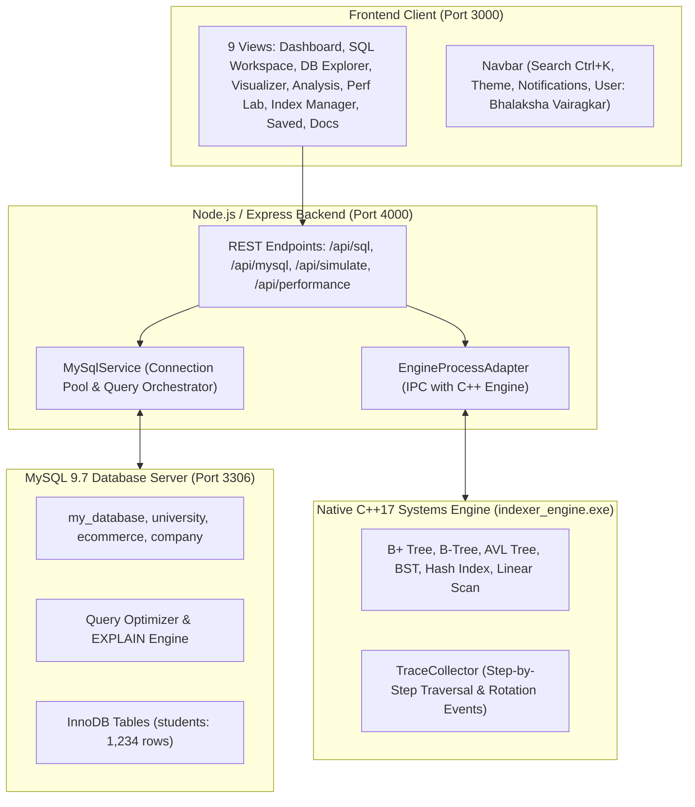

# DBIndex: Full-Stack User-Defined SQL Laboratory & Indexing Simulator

**DBIndex** is an educational engineering platform and database observability dashboard. It integrates a live **MySQL 9.7** database server with a native **C++17 simulation engine** and a **React 18 / Tailwind CSS** interface.

---

## 1. System Architecture



---

## 2. The 9 Core Dashboard Sections (Exact UI Specification)

1. **Dashboard (Page 1):**
   - High-level overview: 4 Databases, 12 Tables, 6 Indexes, 28 Queries Executed.
   - Interactive feature cards: MySQL Engine, Index Simulation, Performance Analytics.
   - Recent activity feed, quick actions, 6 indexing algorithm cards with time complexities.
   - Comparative bar chart (Execution Time, Rows Examined, Disk Accesses, Comparisons).
   - Supported SQL checklist (12 features) & real-time CPU/RAM monitor.

2. **SQL Workspace (Page 2):**
   - Multi-tab SQL query editor (`Query 1`, `Query 2`, `Query 3`, `+`).
   - Run (F5), Format, Explain, Clear, Save, Load actions.
   - Schema Explorer tree showing databases, tables, and column data types with PK badges.
   - Result table and execution plan pipeline viewer.
   - Message status alert and query history log.

3. **Database Explorer (Page 3):**
   - Database and table manager across `my_database`, `university`, `ecommerce`, `company`.
   - Paginated table records for `students` (1,234 rows).
   - Table schema and statistics (Index size: 8.9 MB, Data size: 24 KB).
   - Department distribution bar chart and CGPA histogram analytics.

4. **Index Visualization (Page 4):**
   - Interactive B+ Tree, B-Tree, AVL Tree, BST, Hash Index, and Linear Scan visualizers.
   - Step-by-step search, insert, and delete traversal with active path highlighting.
   - Doubly-linked leaf node visualization with sequential pointers.
   - Leaf node records table and algorithmic complexity reference.

5. **Query Analysis (Page 5):**
   - Side-by-side execution plans: Without Index (Full Table Scan) vs With Index (`idx_department`).
   - Visual execution pipelines and Raw EXPLAIN viewer.
   - Impact comparison metrics, key insights checklist, and cost breakdown donut chart.

6. **Performance Lab (Page 6):**
   - Before-and-after query comparison runner with cache clearing control.
   - Comparative metric cards (Execution time: 892.4 ms vs 12.4 ms; Rows examined: 1,234 vs 56).
   - Speedup analysis (71.9x faster) and complexity comparison ($O(N)$ vs $O(\log N)$).
   - Execution timeline and CPU/RAM resource usage bars.

7. **Index Manager (Page 7):**
   - Index inventory with sizes, storage types (BTREE/HASH), and status.
   - Create new index panel (Basic, Composite, and Advanced options).
   - Miniature tree structure diagram and 24-hour index usage area chart.

8. **Saved Queries (Page 8):**
   - Folder organization: Frequently Used, Index Analysis, Reports, Test Queries.
   - Starred query management and execution history.
   - Integrated query editor and result preview.

9. **Documentation (Page 9):**
   - Interactive guide covering architecture, indexing concepts, and API reference.
   - Code snippet copy utility and performance comparison charts.
   - Table of contents with direct section navigation.

---

## 3. Quick Start & Execution

### Prerequisites
- Node.js 18+ (tested on Node v24)
- MySQL Server 9.7 running on port 3306 (user: `root`, password: `bhalaksha`)
- MinGW / GCC / Clang C++17 compiler (precompiled binary included)

### 1. Initialize Database Schemas & Records
```powershell
cd "C:\Users\BHALAKSH VAIRAGKAR\OneDrive\Desktop\DS cp\backend"
node scripts/init_mysql.js
```

### 2. Start Backend Server
```powershell
cd "C:\Users\BHALAKSH VAIRAGKAR\OneDrive\Desktop\DS cp\backend"
npm start
```
*Backend runs on `http://localhost:4000`.*

### 3. Start Frontend Client
```powershell
cd "C:\Users\BHALAKSH VAIRAGKAR\OneDrive\Desktop\DS cp\frontend"
npm run dev
```
*Frontend runs on `http://localhost:3000`.*

---

## 4. Running Automated Tests

### C++ Engine Unit Tests
```powershell
cd "C:\Users\BHALAKSH VAIRAGKAR\OneDrive\Desktop\DS cp\engine"
.\bin\engine_tests.exe
```
*Output: All 6 index structures tested and passed deterministically.*

### Backend & MySQL Integration Tests
```powershell
cd "C:\Users\BHALAKSH VAIRAGKAR\OneDrive\Desktop\DS cp\backend"
node tests/integration.test.js
```
*Output: 6/6 integration tests passed (Health, MySQL SELECT, EXPLAIN, Performance Comparison, Schema Reflection, C++ Trace).*

---

## 5. Docker Deployment

To launch the full stack with Docker Compose:
```bash
docker-compose up -d --build
```
This starts:
- `mysql`: MySQL 9.0 container on port 3306
- `backend`: Node.js API with C++ engine on port 4000
- `frontend`: React / Nginx container on port 3000
